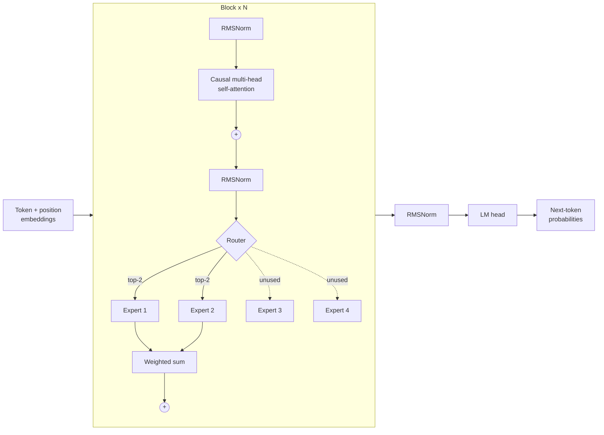

# Mixture-of-Experts Transformer

[](https://github.com/YOUR-USERNAME/moe-transformer/actions/workflows/tests.yml)


A small, readable implementation of a **sparse Mixture-of-Experts (MoE) language model** in PyTorch, in the spirit of Switch Transformer, Mixtral and LLaMA-MoE. Every Transformer block replaces its feed-forward network with several "expert" networks and a router that sends each token to only the top 2 of them. The model has more parameters than it uses for any single token, which is the core idea behind modern large sparse models.

The repo includes a training script, charts of the training run, a web UI that shows which expert handled each character, and a checkpoint you can try right away.


## Results

The included checkpoint is the `tiny` preset trained on [Tiny Shakespeare](https://github.com/karpathy/char-rnn) (1.1M characters, character-level) for 2,000 steps. It took about 16 minutes on a single CPU core.

| | |
|---|---|
| Parameters | 1.35M total, 0.83M active per token |
| Architecture | 4 layers, 4 heads, d_model 128, 4 experts, top-2 routing |
| Validation loss | **1.615** (cross-entropy, nats per character) |
| Next-character accuracy | **51.8%** (random guessing: 1.5%) |

A sample from the model (prompt `ROMEO:`, temperature 0.8):

```text
ROMEO:
His lord shad may the king: but stood and be counter
To a presold matter'd.

SICINIUS:
Do ungry her,
To the is nature when men, my lord need flesh,
But be and for need he and the fair bring in his,
Whose he should the many worse of my grace
They to see faith and with could to soul.
```

It has learned the play format, character names, line lengths and plenty of real words, though not yet meaning. The `small` preset on a GPU gets noticeably further.

### Are the experts actually shared?

A known failure mode of MoE is **expert collapse**: the router sends almost everything to one expert and the rest go unused. A load-balancing loss prevents this. The chart below shows the share of routing decisions each expert received on validation data after training. White is perfectly balanced (25%), indigo is used more, saffron less. Every expert in every layer stays busy.


## How it works



**Router.** A linear layer scores each token against each expert. Softmax turns the scores into probabilities, the top-k experts are kept, and their probabilities are renormalised to sum to 1. During training a little Gaussian noise is added to the scores so the router keeps exploring.

**Experts.** Each expert is an independent two-layer MLP with a SiLU activation. All experts' weights are stored in stacked tensors (`[num_experts, d_model, hidden]`). In the forward pass the tokens are grouped by expert, so each expert runs one matrix multiply over only the tokens sent to it.

**Load-balancing loss.** Following Switch Transformer, the auxiliary loss is `num_experts * sum_i(f_i * P_i)`, where `f_i` is the fraction of tokens routed to expert `i` and `P_i` is the mean router probability for expert `i`. It equals 1.0 when routing is perfectly even and grows when it is lopsided. It is added to the language-modelling loss with weight 0.01.

## Quick start

```bash
git clone https://github.com/YOUR-USERNAME/moe-transformer.git
cd moe-transformer
pip install -r requirements.txt

python app.py          # open http://127.0.0.1:7860
```

The UI has two tabs:

- **Try it**: type a prompt, set length, temperature and top-k, and generate. Below the output, each character is coloured by the expert that handled it. You can switch between layers and see a per-layer load chart for your text.
- **Training**: the loss and accuracy curves, expert load, and a summary of the run, read from `checkpoints/metrics.jsonl`.

Add `--share` to get a temporary public link you can send to someone.

## Train your own

```bash
python train.py --preset tiny --steps 2000     # ~15 min on CPU
python train.py --preset small --steps 5000    # GPU recommended
```

The dataset downloads automatically on first run. To train on your own text, pass `--data path/to/file.txt`.

Training writes the best checkpoint to `checkpoints/model.pt`, logs every evaluation to `checkpoints/metrics.jsonl`, and redraws the charts in `assets/`. You can redraw them at any time with `python plot_metrics.py`.

| Preset | Layers | d_model | Experts | Params | Hardware |
|---|---|---|---|---|---|
| `tiny` | 4 | 128 | 4 | 1.35M | Laptop CPU |
| `small` | 6 | 384 | 8 | 41.5M (13.2M active) | One GPU |
| `base` | 12 | 768 | 8 | 408M (182M active) | Multiple GPUs; needs a subword tokenizer |

Useful flags: `--batch-size`, `--lr`, `--seq-len`, `--eval-every`, `--device cuda|mps|cpu`. Run `python train.py -h` for the full list.

## Use it from Python

```python
import torch
from moe import CharTokenizer, load_model_from_checkpoint

model, ckpt = load_model_from_checkpoint("checkpoints/model.pt")
tok = CharTokenizer.from_dict(ckpt["tokenizer"])

ids = torch.tensor([tok.encode("JULIET:\n")])
out = model.generate(ids, max_new_tokens=200, temperature=0.8, top_k=20)
print(tok.decode(out[0].tolist()))

# See the routing decisions
routing = model(ids, return_routing=True).routing   # list of [batch, seq, top_k] per layer
```

## Project structure

```text
moe-transformer/
├── moe/
│   ├── config.py        # MoEConfig dataclass and presets
│   ├── model.py         # RMSNorm, attention, Router, ExpertMLPBank, MoELayer, Block, MoE
│   └── data.py          # character tokenizer and batching
├── train.py             # training loop with evaluation, logging and checkpointing
├── plot_metrics.py      # draws the charts in assets/
├── app.py               # Gradio web UI
├── tests/test_model.py  # unit tests (shapes, causality, routing, checkpoints)
├── checkpoints/         # demo checkpoint and its metrics
└── assets/              # charts used in this README
```

## Tests

```bash
pytest -q
```

The tests check output shapes, that the causal mask really hides future tokens, that router weights sum to 1, that the grouped expert computation matches a naive per-token loop, the load-balancing loss, checkpoint round-trips, and generation. GitHub Actions runs them and a short training run on every push.

## Deploy the demo

To host the UI for free on [Hugging Face Spaces](https://huggingface.co/spaces), create a new Gradio Space and upload `app.py`, `plot_metrics.py`, the `moe/` folder, `checkpoints/` and `requirements.txt`. The Space runs `app.py` automatically. If the Space doesn't start, change the last line of `app.py` to use `server_name="0.0.0.0"` (or run with `--host 0.0.0.0`).

## Ideas for next steps

- Swap the character tokenizer for a subword tokenizer (for example GPT-2's via `tiktoken`) to train the `base` config on a larger corpus.
- Use SwiGLU experts, as in LLaMA and Mixtral, instead of the plain SiLU MLP.
- Replace learned position embeddings with rotary embeddings (RoPE).
- Add expert capacity limits and token dropping, as in Switch Transformer.
- Build experts by splitting a pretrained dense model's MLP, as in [LLaMA-MoE](https://github.com/pjlab-sys4nlp/llama-moe).

## References

- Shazeer et al., 2017. *Outrageously Large Neural Networks: The Sparsely-Gated Mixture-of-Experts Layer.*
- Fedus, Zoph and Shazeer, 2021. *Switch Transformers: Scaling to Trillion Parameter Models with Simple and Efficient Sparsity.*
- Jiang et al., 2024. *Mixtral of Experts.*
- Zhu et al., 2024. *LLaMA-MoE: Building Mixture-of-Experts from LLaMA with Continual Pre-training.*

## License

MIT
